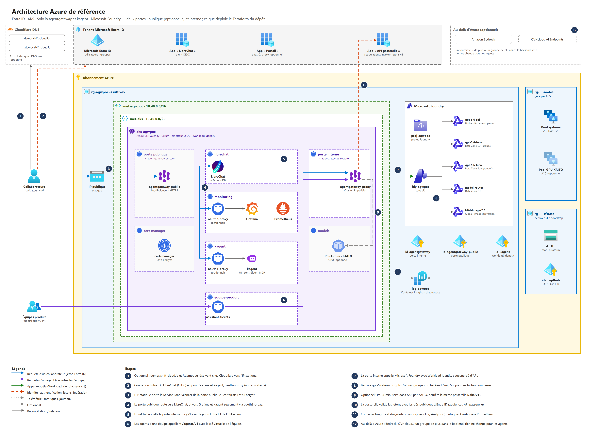

# Agentic AI: to Azure and beyond!

**A cloud-agnostic agentic platform, from field experience to live demo — same stack, any cloud.**
Reference implementation on Azure — Entra ID · AKS · Solo.io agentgateway, kagent, agentregistry · Microsoft Foundry — deployed with Terraform and GitHub Actions.

Companion repository of the talk *« IA agentique : vers Azure et au-delà ! »* — Chalet Azure Romandie, 29 October 2026 — by Antoine LOIZEAU ([Smart Cloud Architect](https://smartcloudarchitect.fr/), [blog](https://blog.smartcloudarchitect.fr/)).

> ⚠️ Demo code. It is built to be understood, deployed and destroyed in an afternoon — not a production landing zone.

## What it shows

- **One gateway for every token.** LibreChat and kagent agents call agentgateway, never a model provider. People come in with their Entra ID token, agents with their team's virtual key; ceilings, guardrails and metrics apply whatever answers behind it.
- **Team onboarding as code.** The AI team's « Agent Ready » pipeline gives a team its identities, storage, namespace, gateway key and repository; the team then ships its agent through two pipelines provided by the AI team.
- **Portable layers.** Everything inside the cluster is the same on AKS, EKS or any Kubernetes. Only two adapters are Azure-specific: identity (Entra ID) and models (Foundry).
- **Declarative agents.** kagent CRDs standardise agents, MCP servers, prompts and skills — an agent is a pull request.
- **Model profiles as configuration.** Sol handles frontier workloads; the daily gateway uses Terra → Luna failover. Bedrock or OVHcloud would be one more group for provider failover.
- **Models inside the cluster (optional).** The AKS AI toolchain operator add-on (KAITO) serves Phi-4-mini on a GPU node behind the same gateway, with the same rules.
- **Public when you want it.** Set `public_exposure` and a second agentgateway Gateway publishes LibreChat, Grafana, the kagent UI and the LLM API on your own domain (Cloudflare DNS, Let's Encrypt, Entra ID sign-in in front of every UI) — same gateway, same policies.
- **Costs you can see.** A Grafana dashboard of tokens, cost (from a model price list) and MCP tool calls per user, team and model, straight from the gateway's metrics — see [monitoring/](monitoring/README.md).

```
People ─► Entra ID ─► LibreChat ──/v1 (user token)──┐
                                                     ├─► agentgateway ──┬─► Microsoft Foundry: Terra → Luna · Sol on demand
Teams ─► kagent agents ──/agents/v1 (team key)──────┘   identity · ceilings├─► KAITO model on AKS (optional, /aks/v1)
                ▲                                       content rules      └─► …Bedrock, OVHcloud: one more group
                └── MCP servers (Jira, …)                    │
                                                             └─► Prometheus / Grafana: tokens & cost per model, team, provider
```

Architecture diagrams (draw.io, with PNG exports): [docs/architecture](docs/architecture/README.md).



## Repository layout

```
gateway/deploy/       gateway core: Gateway, failover backend, MCP backend, routes, policies, usage labels, price list (applied by Terraform)
gateway/public/       optional public Gateway: static IP, HTTPS listeners, Let's Encrypt issuer, public routes
demos/                live demo scripts and runbook (see demos/README.md): A-, B-, C- = 45-min talk (PowerShell), chalet/ = 50-min deck (bash)
monitoring/           Grafana dashboard « Usage IA » (tokens, cost, tools per user) and its generator
docs/architecture/    draw.io diagrams (functional, Azure, Kubernetes, request flow, deployment, exposure, identities, monitoring) + PNG
terraform/            Terraform root + modules
  modules/foundation  resource group, VNet, AKS (OIDC issuer, Workload Identity, Entra ID auth, Cilium, KAITO add-on), container registry
  modules/agent-ready démo B: teams resource group, AI team pipeline identity, constrained role delegation (ABAC)
  teams/              démo B: « Agent Ready » stack, one state per team (identities, storage, roles, namespace, repository) + repository template
  modules/ai          Microsoft Foundry account, project, model deployments (keyless)
  modules/identity    managed identities, federated credentials, Entra app registrations
  modules/platform    Helm: agentgateway, kagent, agentregistry, kube-prometheus-stack, LibreChat; gateway core; team keys; overlays
guardrails/           R&D: NVIDIA NeMo Guardrails behind the agentgateway webhook guard (see its README)
models/               optional: self-hosted model on AKS with KAITO (see its README)
scripts/              preflight.sh (subscription checks), bootstrap-state.sh (state + CI identity)
tools/                check_wiring.py (offline module wiring check)
slides/               deck generators (pptxgenjs): build.js (50 min), build-rex.js (45-min REX, Geneva)
.github/workflows/    agent-ready.yml + reusable agent-image.yml / agent-deploy.yml (démo B); the Terraform workflows (PR, apply) are not in this repository (SECURITE.md)
```

## Prerequisites

- Azure subscription with Owner (or Contributor + Role Based Access Control Administrator), and the right to create Entra app registrations.
- Foundry model quota in the target region (default **Sweden Central**) for gpt-5.6-sol, Terra, Luna, Model Router and MAI-Image-2.6.
- Optional: GPU quota for the KAITO model (`standardNVADSA10v5Family`, 36 vCPU).
- Local tools: Azure CLI, Terraform ≥ 1.9, kubectl, kustomize (bundled in kubectl); on Windows, PowerShell 5.1 or 7 (`scripts/deploy.ps1`, demos of the 45-min talk), GNU make otherwise. Démo B: GitHub CLI (optional).

Check everything first — the script only reads:

```bash
./scripts/preflight.sh            # LOCATION=francecentral ./scripts/preflight.sh
```

### Model catalogue

| Publisher | Deployment | Status by default | Reason |
|---|---|---|---|
| OpenAI/Microsoft | Sol Global, Terra EU, Luna EU | Enabled | GA chat models with quota |
| Microsoft | Model Router EU | Enabled | GA, 300K TPM DataZone quota |
| Microsoft | MAI-Image-2.6 Global | Enabled | Latest available MAI image model; Preview, 6 capacity units quota |
| Anthropic | Opus 5.5, Haiku 4.5 | Disabled | Quota exists, but this subscription cannot purchase Marketplace offers |
| Anthropic | Fable 5.1, Sonnet 5 | Disabled | Marketplace purchase required and quota is zero |
| Mistral AI | Medium 2505, Small 2503 | Disabled | 20K TPM quota exists, but Marketplace purchase eligibility fails |

Disabled entries remain in `model_deployments` with `enabled = false`. Associate a valid payment instrument and verify quota before setting the entry to `enabled = true`. A `terraform.tfvars` override must include the complete map because Terraform does not partially merge map variables.

## Deploy

### From your workstation

**Windows (PowerShell):** one script does the checks, the state storage, `terraform.tfvars`, both phases and the kubectl credentials — every plan is shown and waits for your « oui »:

```powershell
az login
./scripts/deploy.ps1                 # ./scripts/destroy.ps1 to tear everything down
```

**Linux / macOS / WSL:**

```bash
az login
GITHUB_REPO=<owner>/<repo> ./scripts/bootstrap-state.sh   # once: state storage + CI identity
cd terraform
cp terraform.tfvars.example terraform.tfvars             # set subscription_id at least
terraform init -backend-config=backend.hcl
make up          # phase 1 (infrastructure), kubectl credentials, phase 2 (platform)
make cost        # rough monthly estimate

kubectl -n librechat port-forward svc/librechat 3080:3080   # http://localhost:3080, sign in with Entra ID

make down        # destroy everything — do it after each session
```

Nothing is exposed on the internet by default: the gateway is ClusterIP only and LibreChat is reached with a port-forward (its `localhost` redirect URI is registered in Entra ID). See [Public exposure](#public-exposure) to publish it on your own domain.

### Public exposure

Optional. With a domain on Cloudflare:

```powershell
./scripts/deploy.ps1 -PublicZone shift-cloud.io            # asks for the Cloudflare API token if CLOUDFLARE_API_TOKEN is not set
```

or in `terraform.tfvars`, then `CLOUDFLARE_API_TOKEN=<token> make up`:

```hcl
public_exposure = { zone = "shift-cloud.io", subdomain = "demos" }   # acme_email, expose_api optional
```

| URL | What | Sign-in |
|---|---|---|
| `https://demos.shift-cloud.io` | LibreChat | Entra ID (LibreChat's own OIDC) |
| `https://grafana.demos.shift-cloud.io` | Grafana | Entra ID through oauth2-proxy |
| `https://kagent.demos.shift-cloud.io` | kagent UI | Entra ID through the oauth2-proxy bundled with the kagent chart |
| `https://api.demos.shift-cloud.io/v1`, `/agents/v1` | LLM API | Entra ID token / team virtual key — the same policies as inside the cluster |

How it is built:

- **Phase 1** — a static public IP in the main resource group (Network Contributor for the AKS control plane identity), and two Cloudflare `A` records, `demos` and `*.demos`, in **DNS only** mode: Cloudflare's free Universal SSL does not cover second-level names such as `grafana.demos.<zone>`.
- **Phase 2** — cert-manager, and a second Gateway `agentgateway-public` (Service `LoadBalancer` on that IP) with one HTTPS listener per host. cert-manager issues a Let's Encrypt certificate per listener (HTTP-01 through the Gateway, no DNS token in the cluster); port 80 only redirects to HTTPS. Routes live in the namespaces they serve and only labelled namespaces (`agentic.io/public=true`) may attach to this Gateway.
- **Entra ID** — one more app registration, `portail-<base>`, for oauth2-proxy. Single tenant: only accounts of your tenant get in; to narrow it, turn on *Assignment required* on its enterprise application and assign people or groups.
- **Workload Identity** — the public proxy calls Foundry for the API routes with its own managed identity (`id-<base>-agentgateway-public`).

Cloudflare token: *My Profile → API Tokens → Create Token*, permissions **Zone · Zone · Read** and **Zone · DNS · Edit**, restricted to the zone. It stays in the environment of the shell; `destroy.ps1` asks for it again to remove the records.

The first certificates take a few minutes: `kubectl -n agentgateway-system get certificate`.

**Why two phases:** the Helm and Kubernetes providers need a cluster that already exists. Phase 1 builds Azure resources; phase 2 (`deploy_platform = true`) installs the platform.

### From GitHub Actions

See [GitHub setup](#github-setup) below: one bootstrap script, five repository variables, one protected environment. Pull requests then run lint and a plan; **Actions → terraform → Run workflow** runs `apply` or `destroy`.

## GitHub setup

| # | Where | What |
|---|---|---|
| 1 | GitHub | Create the repository (private until the talk), push `main`. |
| 2 | Your terminal | `az login`, then `GITHUB_REPO=<owner>/<repo> ./scripts/bootstrap-state.sh`. It creates the state storage account (Entra auth only) and two user-assigned managed identities: `id-<prefix>-github-plan`, federated with pull requests — Reader, state Reader; `id-<prefix>-github`, federated with environment `demo` only — Contributor, Resource Policy Contributor, Role Based Access Control Administrator under an ABAC condition (the roles the platform assigns, to service principals only: never Owner, never a person), Storage Blob Data Contributor on the state. No credential for a branch: a push or a merge never runs with the apply identity. |
| 3 | Settings → Secrets and variables → Actions → **Variables** | `AZURE_CLIENT_ID` (environment `demo`), `AZURE_CLIENT_ID_PLAN` (pull requests), `AZURE_TENANT_ID`, `AZURE_SUBSCRIPTION_ID`, `TFSTATE_RG`, `TFSTATE_ACCOUNT` — values printed by the script. Variables, not secrets: none of them is sensitive. The pull-request job logs in with `AZURE_CLIENT_ID_PLAN`, which has no access to the state account: it runs `terraform fmt -check` and `terraform init -backend=false && terraform validate` only. Plans and applies run in the protected environment. |
| 4 | Settings → **Environments** | Create `demo`, add yourself as required reviewer, restrict deployment branches to `main`. `apply` and `destroy` wait for your approval. |
| 5 | Settings → Actions → General | Workflow permissions: read repository contents (the workflows request `id-token: write` themselves). Allow GitHub Actions to create and approve pull requests: off. |
| 6 | Settings → Branches | Protect `main`: pull request required, status check `terraform / lint` required. |
| 7 | Entra ID (tenant admin, once) | If the pipeline must create the two app registrations, grant the managed identity Microsoft Graph **Application.ReadWrite.OwnedBy**. Otherwise run the first apply from your workstation, or set `create_entra_apps = false`. |
| 8 | Settings → Secrets and variables → Actions | Public exposure only: secret `CLOUDFLARE_API_TOKEN`, variable `PUBLIC_EXPOSURE` = `{zone="shift-cloud.io",subdomain="demos"}`. |
| 9 | Packages | NeMo only: by default the adapter image is `<acr>/plateforme/nemo-guardrail-adapter:0.1.0` (build it with `az acr build` after phase 1, as `scripts/deploy.ps1` does). To use the image the `guardrail-adapter` workflow pushes to `ghcr.io/<owner>/nemo-guardrail-adapter` instead, set the package visibility and put that image (lowercase) in `guardrail_adapter_image`. |

Authentication is OIDC federation end to end: no client secret, no storage key, nothing sensitive stored in GitHub.

## Demos

45-minute talk: three live demos in PowerShell (rate limit + Entra ID token, « Agent Ready » teams with GitHub pipelines, NeMo Guardrails). 50-minute deck: five demos in bash. Each has a self-narrating script and a fallback video: see [demos/README.md](demos/README.md).

## Main options (`terraform.tfvars`)

| Variable | Default | Effect |
|---|---|---|
| `location` | `swedencentral` | Region for everything |
| `model_deployments` | 5 enabled | Sol, Terra, Luna, Model Router and MAI-Image-2.6; six Marketplace entries are catalogued but disabled |
| `create_entra_apps` | `true` | Gateway API and LibreChat app registrations |
| `teams` | `["equipe-produit"]` | Teams onboarded: namespace + gateway virtual key for their agents |
| `ai_team_github_repository` | `null` | `owner/repo` of this repository: identity of the AI team's « Agent Ready » pipeline (environment `ai-team`), with bounded Azure and Kubernetes rights (démo B) |
| `aks_admin_group_object_ids` | `[]` | Entra ID groups bound to cluster-admin (Entra ID authentication is on; the presenter and Terraform use the admin kubeconfig) |
| `aks_admin_current_principal` | `true` | The identity running Terraform administers the whole AKS cluster: Azure Kubernetes Service RBAC Cluster Admin (Kubernetes API through Entra ID, `kubelogin`, no `--admin`), Cluster Admin Role and Contributor Role on the cluster. Azure RBAC for Kubernetes is on, next to Kubernetes RBAC (teams' RoleBindings). Set `false` in CI |
| `authorized_principal_object_ids` | `[]` | Users or groups allowed to sign in to the gateway API, LibreChat and the portal. Every one of these apps requires an assignment: besides the identity running Terraform, nobody gets in until listed here |
| `assign_current_principal` | `true` | Also assign the identity running Terraform to the apps above. Set `false` in CI (with a non-empty `authorized_principal_object_ids`): otherwise a CI apply and a workstation apply keep removing each other's assignment |
| `ai_team_manage_role_assignments` | `true` | Terraform creates the AI team's Contributor and conditioned RBAC Administrator assignments. Set `false` in CI (the CI identity can no longer grant those roles) and run `demos/B-agent-equipe/prepare.ps1` once as Owner; on an existing state, first `terraform state rm` both assignments |
| `aks_api_authorized_ip_ranges` | `[]` | CIDR ranges allowed to reach the AKS API server; empty = the internet, authentication only. Set your workstation and CI egress ranges |
| `usage_metrics_per_user` | `true` | `user` label on the gateway metrics (usage dashboard per person); set `false` for thousands of users — team, model, cost and tools remain |
| `public_exposure` | `null` | `{ zone, subdomain = "demos", acme_email, expose_api = false }`: LibreChat, Grafana and the kagent UI on HTTPS under `<subdomain>.<zone>`, plus the LLM API with `expose_api = true`; `null` = nothing public, port-forward only |
| `enable_nemo_guardrails` | `false` | NeMo Guardrails behind the gateway (R&D target; production today uses Foundry content filters). Build the adapter image first: the webhook is fail-closed |
| `guardrail_adapter_image` | `null` | `null` = `<acr>/plateforme/nemo-guardrail-adapter:0.1.0`, built by `scripts/deploy.ps1`; or any lowercase image reference (e.g. the one built by `guardrail-adapter.yml`) |
| `enable_self_hosted_models` | `false` | KAITO add-on + Phi-4-mini on a GPU node, route `/aks/v1` |
| `self_hosted_gpu_instance_type` | `Standard_NV36ads_A10_v5` | GPU size for KAITO (Ampere or newer) |

## Cost

| Item | Estimate |
|---|---|
| AKS control plane (Free tier) | 0 |
| 2 × D4as_v5 nodes (default) | ≈ 0.37 USD/hour (≈ 269 USD/month if left running) |
| Production example, 3 × D8as_v5 + Standard tier (SLA) | ≈ 879 USD/month (≈ 391 with 3-year reservations) |
| Production example, 6 × D8as_v5 + Standard tier (SLA) | ≈ 1 685 USD/month (≈ 710 with 3-year reservations) |
| Foundry inference for the demo | Usage-based; verify current model pricing |
| KAITO GPU node, optional (A10, Sweden Central) | ≈ 4.16 USD/hour |
| Static public IP, optional (public exposure) | ≈ 0.005 USD/hour |

Retail prices (Azure Retail Prices API, Sweden Central, Linux, 730 h/month), checked October 2026; nodes only plus the AKS control plane — disks, load balancer, logs and egress excluded. **Destroy between sessions.**

## Security notes

- Keyless end to end: Foundry has `local_auth_enabled = false`; the gateway and kagent use AKS Workload Identity; Terraform state uses Entra auth with shared keys disabled.
- The gateway validates Entra ID v2 tokens (`requested_access_token_version = 2`); requests without a valid token never reach a model.
- Only the gateway proxies can reach the guardrail adapter and the self-hosted model (NetworkPolicies, Cilium).
- Only assigned users and groups sign in (`authorized_principal_object_ids`): the gateway API, LibreChat and the portal all require an Entra ID app role assignment — the rest of the tenant, guests included, is refused by Entra ID.
- Public exposure (optional) adds three HTTPS entry points on one IP — four with `expose_api = true` (off by default); every one of them requires Entra ID (or a team key for `/agents/v1`). Grafana and the kagent UI are never routed directly, only through oauth2-proxy; Grafana only accepts its header sign-in from inside the monitoring namespace (NetworkPolicy), and new users are Viewers.
- Tools are allow-listed per route at the gateway (`gateway/deploy/autorisations-mcp.yaml`): people see `list_agents`, `invoke_agent` and the read tools of team MCP servers, never their write tools.
- Team namespaces enforce Pod Security `baseline` and accept only ClusterIP Services with a selector (admission policies `agent-ready-perimetre`, `equipes-services`); the kagent, agentregistry and Grafana pods only accept the callers they need (`terraform/modules/platform/network-policies.tf`).
- The security review of October 2026 and what it changed: [SECURITE.md](SECURITE.md).

## Known limits

- `terraform validate` has not been run in CI yet on this exact provider set — run `make validate` first.
- The per-team token attribution relies on a CEL-derived label; watch Prometheus cardinality at scale.
- LibreChat forwards the user's Entra token from v0.8.8 (release candidate at the time of writing, chart 2.0.14).
- Local token ceilings are per route; a budget per team needs agentgateway's global rate limit and an external rate-limit service.
- KAITO GPU node pools must be deleted manually after `kubectl delete workspace` (documented by Microsoft).
- Workload Identity of the proxies assumes the agentgateway controller names each proxy's ServiceAccount after its Gateway (`agentgateway-proxy`, `agentgateway-public`); check with `kubectl -n agentgateway-system get sa` if Foundry answers 401.

## References

- agentgateway — <https://agentgateway.dev/docs/kubernetes/latest/>
- kagent — <https://kagent.dev/docs>
- Microsoft Foundry — <https://learn.microsoft.com/azure/ai-foundry/>
- AKS AI toolchain operator (KAITO) — <https://learn.microsoft.com/azure/aks/ai-toolchain-operator>
- NVIDIA NeMo Guardrails — <https://github.com/NVIDIA/NeMo-Guardrails>
