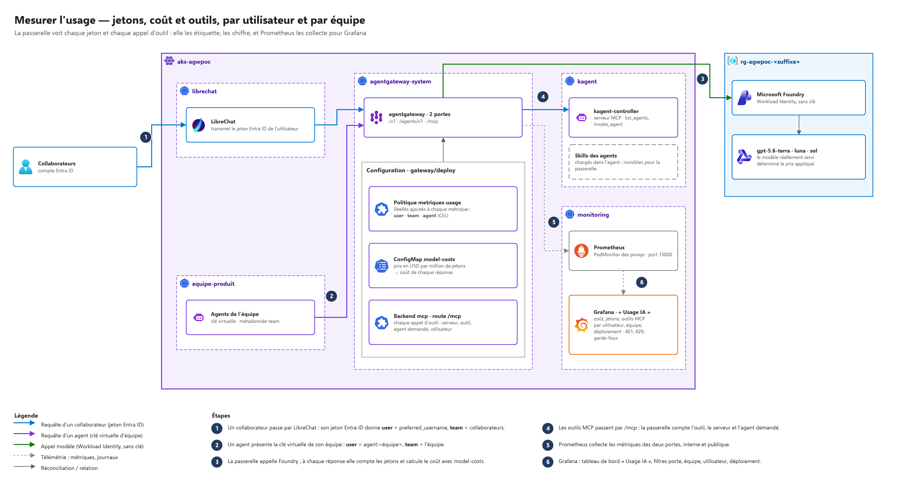

# Usage monitoring — who consumes what, at what cost, with which tools

Grafana dashboard **« Usage IA — utilisateurs, coûts, outils »** (folder *Plateforme IA*), provisioned by Terraform
(`terraform/modules/platform/monitoring.tf`). Every figure comes from the gateway: one place sees every LLM
token and every tool call, whichever front end, agent or model is involved.



## What it shows

| Section | Panels | Source metric (agentgateway v1.5.0) |
|---|---|---|
| Vue d'ensemble | LLM cost, 30-day projection, input / output tokens, active users, MCP tool calls | `gen_ai_client_cost_usd_total`, `gen_ai_client_token_usage`, `mcp_requests_total` |
| Par utilisateur | table (cost, requests, tokens, tool calls per user and team), top 10 tokens, cost per hour | same, by `user`, `team` |
| Par équipe et par modèle | cost by team, cost by Foundry deployment, team × deployment, tokens per minute, LLM latency and time to first token | `gen_ai_request_model`, `gen_ai_server_request_duration`, `gen_ai_server_time_to_first_token` |
| Outils MCP | tools called (server · tool), agents asked through `invoke_agent`, MCP requests by method, who uses which tool | `mcp_requests_total` (`method`, `server`, `resource`, `agent`) |
| Recherche web (DuckDuckGo) | searches, pages fetched, active users, top users, calls per tool and per user over time | `mcp_requests_total` (`server="web-search"`, `resource` = `search` / `fetch_content` / `expand_link`) |
| Accès et plafonds | 401, 429, responses with no price, responses by HTTP code (guardrails: see the « Garde-fous » dashboard below) | `requests_total`, `cost_catalog_lookups_total` |
| Skills | why they are not on this dashboard (below) | — |

Filters: door (internal / public), team, user, Foundry deployment.

Open it: `kubectl -n monitoring port-forward svc/kps-grafana 3000:80` → <http://localhost:3000>, or
`https://grafana.<subdomain>.<zone>` with public exposure (Entra ID sign-in).

## What feeds it (all in `gateway/deploy`)

| File | Role |
|---|---|
| `metrics.yaml` | `AgentgatewayPolicy` *metriques-usage* on both Gateways: adds `user` (Entra ID `preferred_username`, or `agent:<team>` for a virtual key), `team` (virtual key metadata, `collaborateurs` for people) and `agent` (the kagent agent named in an `invoke_agent` call) to every metric |
| `model-costs.json` | price list, mounted as ConfigMap `model-costs` and referenced by both `AgentgatewayParameters` (`spec.modelCatalog`): each response adds its cost to `agentgateway_gen_ai_client_cost_usd_total` |
| `backend-mcp.yaml`, `routes.yaml` | MCP through the gateway: LibreChat calls `/mcp` with the user's Entra ID token (policy `acces-outils`), the gateway forwards to the kagent MCP server and counts every tool call |

## Prices

USD per 1M tokens, Microsoft Foundry **Standard Global** list prices, short context, as published by Microsoft
([GPT-5.6 now available in Microsoft Foundry](https://azure.microsoft.com/en-us/blog/gpt-5-6-now-available-in-microsoft-foundry/)):

| Model | Input | Cached input | Cache writes | Output |
|---|---|---|---|---|
| gpt-5.6-sol | 5.00 | 0.50 | 6.25 | 30.00 |
| gpt-5.6-terra | 2.00 | 0.20 | 2.50 | 12.00 |
| gpt-5.6-luna | 0.20 | 0.02 | 0.25 | 1.20 |

- Terra and Luna are deployed as **Data Zone Standard** (EU processing). Microsoft does not publish a Data Zone
  price for these models, so the dashboard uses the Global list price: an estimate, not an invoice.
  Put your negotiated or Data Zone prices in `model-costs.json` when you have them.
- Sol's promotional price (4.00 input / 20.00 output, 1 September – 30 November 2026) is not applied: the list
  price is kept so the figures stay valid after the promotion.
- Each model is listed twice: under its **deployment name** (the model the gateway sends, used as a fallback) and
  its **model name** (returned by Foundry, tried first). A model missing from the list shows up in
  *Réponses sans prix* — keep that panel at 0.
- The self-hosted model (optional, `models/`, provider `kaito`) is listed at 0: no per-token price, you pay the GPU
  node by the hour. It stays out of *Réponses sans prix* and shows next to Foundry in the dashboard (self-hosted model demo, Chalet deck).
- Format: `{"providers": {"azure": {"models": {"<name>": {"rates": {"input", "output", "cacheRead", "cacheWrite"}}}}}}`,
  amounts as strings, at most 6 decimals, unknown fields rejected.

## Guardrails dashboard

A second dashboard, **« Garde-fous — déclenchements par équipe, règle, profil »** (same folder, `monitoring/dashboards/garde-fous.json`,
generated by `monitoring/src/guardrails_dashboard.py`, provisioned by `monitoring.tf`), answers one question: *who triggers which
guardrail, and should it be adapted for one application or agent?*

| Section | Panels | Source metric |
|---|---|---|
| Vue d'ensemble | checks, rejects, masks, block ratio, engine errors, p95 latency | `guardrail_adapter_decisions_total`, `guardrail_adapter_errors_total`, `guardrail_adapter_check_duration_seconds` |
| Qui a arrêté la requête | pie and table by mechanism (`adapter` Python checks, `nemo-regex`, `nemo-injection`, `nemo-llm`, `moteur`) × rule, plus the gateway's own layer 1 | `guardrail_adapter_decisions_total{source,rail}`, `agentgateway_guardrail_checks_total` |
| Qui déclenche quoi | table team × rule × profile × direction, top rules, block ratio per team, per model, per minute | `guardrail_adapter_decisions_total{direction,action,rail,profile,team,model,source}` |
| Messages bloqués | table of the last blocked / masked messages: time, decision, mechanism, rule, team, user, profile, model, which message, **masked text** | adapter logs in Log Analytics (`ContainerLogV2`), Azure Monitor data source |
| Vue passerelle | 403 / 5xx on LLM routes per route × team × user, gateway guardrail checks | `agentgateway_requests_total`, `agentgateway_guardrail_checks_total` |
| Santé du moteur | engine errors, latency p50/p95/p99, adapter replicas | adapter metrics |
| Comment s'en servir | reading guide and the ways to adapt rails for one application | — |

`team` on the adapter metrics comes from the `x-team` header set by the webhook policy (`guardrails/deploy/gateway/guardrail-policies.yaml`,
same expression as `metrics.yaml`); `model` from `x-model`. Per-person detail is **not** a label (cardinality): each reject / mask / engine
error is one log line of the adapter (`decision=… rail=… profile=… team=… user=… model=…`, never the prompt).
### Blocked messages table

Prometheus holds no text, so the table reads the adapter's logs: with `LOG_BLOCKED_CONTENT=true` (set in `guardrails/deploy/base/adapter.yaml`)
each reject / mask writes one JSON line (`event=guardrail_block`, decision, mechanism, rule, team, user, model and a **masked, truncated preview**).
AKS already ships container logs to Log Analytics; Grafana reads them through an Azure Monitor data source (uid `azure-loganalytics`, Terraform:
`grafana` workload identity with *Log Analytics Reader* on the workspace, no secret). The preview hides what triggered the rule: secrets → `[SECRET]`,
runs of 6+ digits (card, NIR, IBAN, phone) → `[NUM]`, opaque tokens of 24+ characters → `[JETON]`, 300 characters at most (`BLOCKED_PREVIEW_CHARS`).
Masking is deliberately broad but is **not a guarantee**: free text can still be personal ("Mon patient Jean Dupont…"). Treat the table as sensitive:
Grafana here allows anonymous Viewer access (`auth.anonymous` in `main.tf`, demo only) — restrict the dashboard (or set `LOG_BLOCKED_CONTENT=false`)
outside a throwaway cluster. Needs Grafana ≥ 10.3 for workload identity (`azure.workload_identity_enabled`); ingestion delay: a few minutes.

If the `Équipe` column shows `-`, the gateway did not pass `x-team` (the CEL `apiKey.team` in webhook headers is to be validated, D-7).

## Per-user labels and cardinality

A `user` label means one Prometheus series per user × model × route (× histogram bucket for tokens). Fine for a
demo or a pilot. For thousands of people, set `usage_metrics_per_user = false` in `terraform.tfvars`: Terraform
removes the `user` label and the dashboard keeps team, model, cost and tools. Keep per-person detail in the
gateway access logs or OpenTelemetry traces (Log Analytics), where cardinality costs nothing.

## Skills

kagent skills (`Agent.spec.skills`) are folders of instructions and scripts loaded **inside** the agent from an OCI
image or a Git repository. Using one is not a network call, so **no gateway can see it**, and this dashboard does
not count skills. What it does count: the agents' LLM cost and tokens (`team`), the agents asked through
`invoke_agent`, and the MCP tools that go through the gateway. To follow skill usage, instrument the agents:
kagent OpenTelemetry tracing (`otel.tracing` chart values) to Azure Monitor / Application Insights.

## Tool calls made by agents

An agent calling its own MCP server directly (Chalet self-service demo: `assistant-tickets` → `jira-mcp` in the team namespace)
does not go through the gateway, so those calls are not counted. To count them, publish the team's MCP server as
one more target of the `mcp` backend on a route protected by the team's virtual key, and point the agent at the
gateway (kagent `RemoteMCPServer`) instead of the `MCPServer`: its tools then appear in the *Outils MCP* section,
attributed to the team.

## Regenerate

```bash
python3 monitoring/src/usage_dashboard.py   # writes monitoring/dashboards/usage-ia.json
```

Edit the generator, not the JSON: CI regenerates it and fails on a difference.
